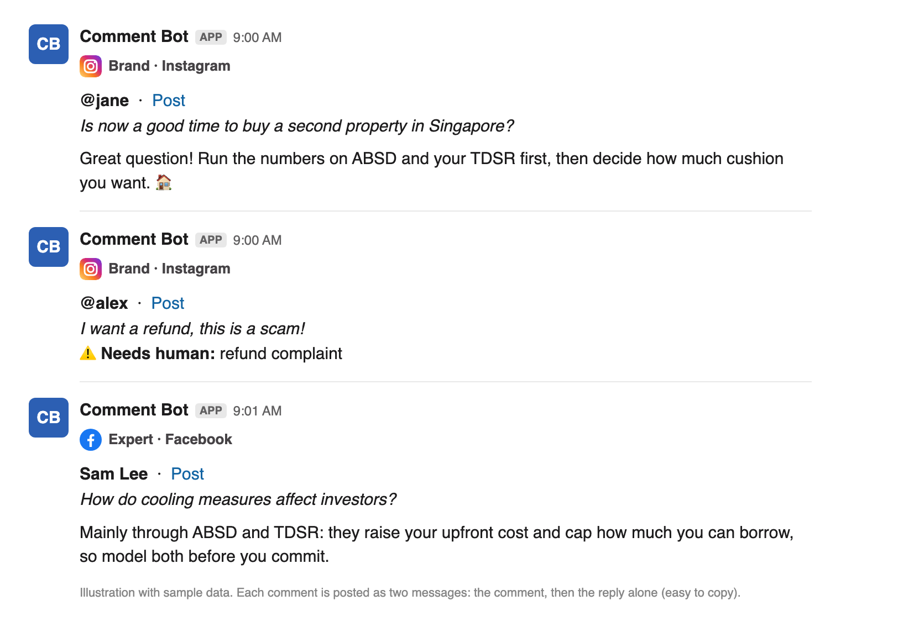

# Comment Reply Bot

🇬🇧 English · 🇻🇳 [Tiếng Việt](README.vi.md)

Automatically picks up new comments on **Instagram**, **Facebook Pages** and **YouTube**, lets **Claude** filter out spam and draft replies (in the right voice for each account), then posts them to **Slack** so your team can copy and publish them. The bot is **read-only** towards Meta and YouTube: it never posts, hides or deletes any comment.

## How it works

```
Schedule (hourly)  →  Claude reads skill/SKILL.md
                         │
                         ├─ python3 comment_bot.py fetch   (fetch + filter new comments from Meta)
                         ├─ Claude classifies (reply / needs human / spam) and writes the replies
                         └─ python3 comment_bot.py post -  (posts each comment to Slack)
```

Each comment becomes **two consecutive Slack messages**:

1. platform icon, `Account · Platform`, `@user · Post` (clickable link), the comment in italics
2. the reply only (long-press on mobile → *Copy text*)

Comments that need a human (complaints, refunds, …) only get message 1, plus a ⚠️ *Needs human* line.

**What it looks like in Slack** (illustration with sample data):



Duplicate protection needs no database: every message carries the comment ID in its `block_id`, and before posting the script reads the channel history and skips comments that are already there.

## What's inside

| File | Role |
|---|---|
| `comment_bot.py` | The script (Python 3, no extra packages). Commands: `fetch` and `post` |
| `skill/SKILL.md` | Instructions for Claude (the body of the scheduled task / routine) |
| `rules.example.md` | Template for your spam rules and reply voices. Copy to `rules.md` (git-ignored) |
| `.env.example` | Config template. Copy to `.env` and fill in your tokens |

## Requirements

- Python 3.8+
- An Instagram **Business/Creator** account linked to a **Facebook Page**
- A Meta app with a Page token that has `instagram_basic`, `instagram_manage_comments`, `pages_show_list`, `pages_read_engagement`, `pages_read_user_content`
- *(Optional, for YouTube)* a Google Cloud project with **YouTube Data API v3** enabled and an **API key** (read-only is enough), plus your channel ID(s)
- A Slack app with a bot token (`xoxb-...`), scopes `chat:write` and `channels:history` (private channels: `groups:history`), and the bot invited to the channel
- Claude Code / the Claude app to run a scheduled task, or a routine on Claude web

## Setup

1. Clone the repo, for example:
   ```bash
   git clone <repo-url> ~/comment-reply-bot
   cd ~/comment-reply-bot
   cp .env.example .env
   ```
2. Fill in `.env` (see `.env.example`). **Never commit `.env`** (it is already in `.gitignore`).
   - **Instagram ID, Page ID, Page token:** Graph API Explorer → pick your app → `GET /me/accounts` for the Page token; get the Instagram ID from `GET /{page-id}?fields=instagram_business_account`.
   - **Slack:** api.slack.com/apps → your app → *OAuth & Permissions* → Bot User OAuth Token. Channel ID: right-click the channel → *View channel details*.
3. Copy `rules.example.md` to `rules.md` and describe your spam rules and the voice of each account (see *Customization*).

## Try it by hand

```bash
cd ~/comment-reply-bot && set -a && . ./.env && set +a

# 1) See new comments (read-only). Raise LOOKBACK_HOURS to see older ones.
LOOKBACK_HOURS=168 python3 comment_bot.py fetch

# 2) Post a sample comment to Slack
python3 comment_bot.py post - <<'JSON'
{"sections":[{"account":"Brand","platform":"Instagram","items":[
 {"id":"TEST-1","user":"@test","link":"https://www.instagram.com/p/EXAMPLE/",
  "comment":"[TEST] Is now a good time to buy property?","reply":"Great question! ...",
  "needs_human":false,"reason":""}]}]}
JSON
```

Running it again with the same `id` prints `posted 0, skipped 1 already in channel`.

## Run it automatically

### Option A: Scheduled task on your computer (Claude app)

Your computer must be on and the Claude app open. Create a new task in the Claude app, schedule it e.g. hourly from 8am to 11pm (`0 8-23 * * *`, local time), and paste the contents of `skill/SKILL.md` as its instructions. Edit the `$HOME/comment-reply-bot` path in the skill if you cloned elsewhere.

### Option B: Routine on Claude web (runs 24/7, even when your computer is off)

Minimum schedule is 1 hour. The cloud has neither your `.env` nor your script, so:

1. Put the variables from `.env.example` into the cloud environment's **environment variables** on claude.ai.
2. Allow network access to `graph.facebook.com` and `slack.com`.
3. Get `comment_bot.py` into the routine: use this repo (GitHub) as the routine's source, or paste the script into the instructions and tell Claude to write it to a file and run it.
4. Paste `skill/SKILL.md` as the instructions, minus the line that loads `.env`.

Note: your Meta and Slack tokens will live in the cloud environment settings. Make sure your organization allows that.

## Customization

- **Accounts and display names:** set `ACCOUNT_NAME` and `ACCOUNT_NAME_PERSONAL` in `.env`; the Meta/Slack IDs and tokens are the other variables in `.env.example`. The account list itself lives in the `sources()` function of `comment_bot.py`.
- **Voices, spam rules, reply length:** copy `rules.example.md` to `rules.md` (git-ignored, so your rules stay private) and edit it. `skill/SKILL.md` makes Claude read `rules.md`.
- **How far back to look:** `LOOKBACK_HOURS` (default 24 hours).
- **Slack pacing:** `SLACK_PAUSE` (default 4 seconds between comments).
- **Slack channel:** `SLACK_CHANNEL_ID`.

## Notes and limits

- Only comments from the last `LOOKBACK_HOURS` hours are fetched: the 15 most recent Instagram posts, the 10 most recent Facebook posts, and the latest 100 top-level YouTube comments across the channel.
- YouTube uses a read-only API key (no OAuth). Each fetch costs about 1 quota unit (default quota: 10,000 units/day).
- Spam (SKIP) comments never reach Slack, so Claude re-evaluates them on later runs while they are still inside the lookback window. The cost is small.
- Slack allows roughly 1 message per second per channel; the script pauses between comments and retries when rate-limited.
- Meta tokens from Graph API Explorer expire quickly. Use a long-lived Page token or a System User token for long-term use.
- Replies written in an expert's voice are educational only, not personal investment advice. Review them before publishing.

## Troubleshooting

| Symptom | Likely cause |
|---|---|
| `fetch` reports `Meta HTTP 400 code=190` | Token expired or wrong |
| `fetch` reports `YouTube HTTP 403` | API key missing/restricted, YouTube Data API v3 not enabled, or quota exceeded |
| `fetch` reports `code=100 ... nonexisting field` | Wrong Page/Instagram ID (e.g. an Instagram ID used as the Page ID) |
| `Slack ... not_in_channel` | The bot has not been invited to the channel |
| `Slack ... missing_scope` | Missing `chat:write` or `channels:history`; add it, then *Reinstall to Workspace* |
| No messages in Slack | No new comments within the lookback window, or all of them were spam |
